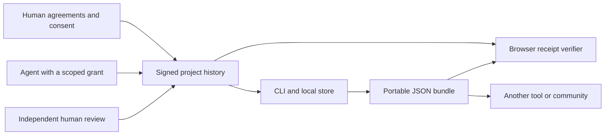

# Architecture

This page describes the original ordered 0.1 reference. The [open 0.2 graph](open-protocol.md) removes the membership gate and single sequence; [economic contracts](economics/contracts.md) add explicit ownership and revenue enforcement. Both formats remain supported. A signed graph claim or settlement locator does not automatically become a verified contract award.

Koinos separates portable collaboration records from the tools that create and read them. This reference uses files so a project can be copied, checked, and inspected without a hosted service.

## Records and state

The protocol module checks signatures and applies a deterministic state machine. No record can silently change an earlier statement. Revocation, withdrawal, and disputes become new records. Consumers can reconstruct both the current view and the history that produced it.

All records in a bundle belong to one project. A complete bundle starts with project creation. References point backward to exact record hashes. This makes a contribution's attribution, agreement, grant, review, and acceptance traceable without a database maintained by one hub.

## Explicit authority

The initial project signer is its steward. People sign their own consent to a fixed agreement reference. A grant lets one named agent submit work for one person under that agreement until expiry or revocation. It never permits the agent to consent, issue another grant, review its own work, or accept it.

An independent human agreement party reviews the submitted artifact reference. Acceptance must name the latest approving review. Consent must remain active, and an agent's grant must still be valid at acceptance. Withdrawal or revocation does not rewrite a previously accepted contribution. A dispute adds an explicit contested state.

## Consumers

The CLI is the reference authoring tool. The browser provides a second receipt verifier using WebCrypto, separate from Node's crypto implementation. Browser receipt verification and full protocol validation are separate results: a correctly signed action may still be unauthorized.

The demonstration uses roles inspired by Exofab and Synbios. It does not connect to either product. An adapter to a real service should translate an explicitly authorized action into a signed record, retain the original evidence reference, and preserve all signatures on export.

## Deliberate limits

This version uses one ordered log per project and detects conflicting histories. It has no peer discovery, global network, leader election, distributed clock, identity recovery, or automatic conflict resolution. File storage is a reference transport. Other transports must preserve exact record meaning and verify the same rules.

Separate agreement references can describe different economic arrangements. Koinos records consent to their digests. It does not interpret those documents, calculate entitlements, transfer money, issue tokens, or incorporate entities.
